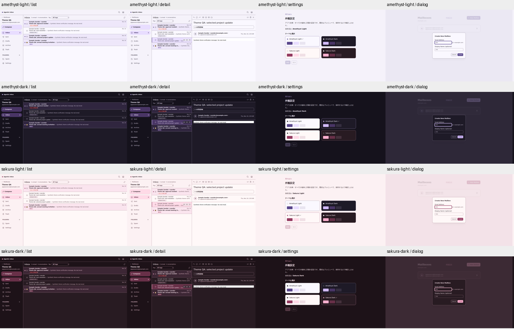
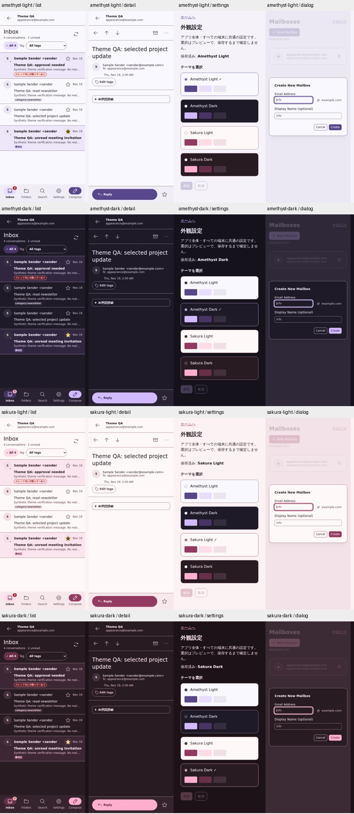

<!-- SPDX-License-Identifier: Apache-2.0 -->
# App-wide appearance QA — 2026-11-19 JST

Only a local Worker, local R2/DO state and four synthetic emails at
`appearance@example.com` were used. No production request, email delivery,
AI inference, deployment or merge was performed. Node v24.22.3 was reused
from the existing user-space installation; dependencies were copied into the
isolated worktree, with no lockfile changes or new dependencies.

## Visual matrix

All 32 chrome states were opened and visually inspected in OpenBot's embedded
Chromium. PC: innerWidth 1280, scrollWidth 1265. Phone: innerWidth 390,
scrollWidth 375. The 15px difference is the browser scrollbar, not clipping.
`matrix.json` records each case and its limitation. Full screenshots are linked
below; composite images are generated from those screenshots, not UI mockups.

| Theme | Device | List | Detail | Appearance | Dialog |
|---|---|---|---|---|---|
| Amethyst Light | PC | [image](amethyst-light-pc-list.png) | [image](amethyst-light-pc-detail.png) | [image](amethyst-light-pc-settings.png) | [image](amethyst-light-pc-dialog.png) |
| Amethyst Dark | PC | [image](amethyst-dark-pc-list.png) | [image](amethyst-dark-pc-detail.png) | [image](amethyst-dark-pc-settings.png) | [image](amethyst-dark-pc-dialog.png) |
| Sakura Light | PC | [image](sakura-light-pc-list.png) | [image](sakura-light-pc-detail.png) | [image](sakura-light-pc-settings.png) | [image](sakura-light-pc-dialog.png) |
| Sakura Dark | PC | [image](sakura-dark-pc-list.png) | [image](sakura-dark-pc-detail.png) | [image](sakura-dark-pc-settings.png) | [image](sakura-dark-pc-dialog.png) |
| Amethyst Light | Phone | [image](amethyst-light-mobile-list.png) | [image](amethyst-light-mobile-detail.png) | [image](amethyst-light-mobile-settings.png) | [image](amethyst-light-mobile-dialog.png) |
| Amethyst Dark | Phone | [image](amethyst-dark-mobile-list.png) | [image](amethyst-dark-mobile-detail.png) | [image](amethyst-dark-mobile-settings.png) | [image](amethyst-dark-mobile-dialog.png) |
| Sakura Light | Phone | [image](sakura-light-mobile-list.png) | [image](sakura-light-mobile-detail.png) | [image](sakura-light-mobile-settings.png) | [image](sakura-light-mobile-dialog.png) |
| Sakura Dark | Phone | [image](sakura-dark-mobile-list.png) | [image](sakura-dark-mobile-detail.png) | [image](sakura-dark-mobile-settings.png) | [image](sakura-dark-mobile-dialog.png) |

No teal scope overrides remain. Computed M3/mobile/Kumo primary values matched
`#59478b`, `#d1baff`, `#943a60`, `#ffafce` in theme order. Unread markers and
font weights, selected borders, checkmarks and tag/error labels remain distinct
without relying only on color. Dialogs inherit the root palette. Destructive hover uses a foreground-safe
blend rather than Kumo's low-contrast alpha hover, with its own ratio test. Kumo's
important white primary/destructive text was found to conflict with pale dark
buttons; an earlier important CSS layer now supplies paired foregrounds.

### Limits observed (not silently counted as email-renderer passes)

Phone HTML email body iframes were blank in these development captures; their
srcdoc contained the synthetic body and the sandbox remained unchanged.
Desktop captures rendered the original white email document. One desktop
capture required closing/reopening detail; resizing to the desktop breakpoint
also made the phone body visible afterward. The cause and production behavior
are **unconfirmed**. This theme patch changes neither EmailIframe nor email
body/sandbox handling. Treat the phone matrix as chrome coverage, not proof of
HTML mail-body rendering. Actual device/browser and deployed Access checks
remain for the owner's review.

The existing Kumo create-mailbox dialog emitted an aria-hidden/focused-trigger
warning while opening; focus subsequently moved to its textbox and its focus
ring is visible. Its focus-management code was not changed by this patch.

## Additional checks

- All four themes: 767px uses mobile chrome (scrollWidth 752); 768px switches
  to desktop (scrollWidth 753), retaining a 393px detail pane and the right
  palette. No horizontal overflow. See `boundaries.json`.
- 820px tablet: scrollWidth 805, detail pane 445px. Selected row background
  `rgb(104,48,72)` and 3px border `rgb(255,175,206)` in Sakura Dark after the
  existing transition completed. Hover, unread/star, tag/error labels inspected.
- Search Popover at 768px: width 416px, background `rgb(40,27,34)`, foreground
  `rgb(255,234,242)` and visible keyboard focus; screenshot
  [boundary-768-popover-focus.png](boundary-768-popover-focus.png).
- Existing mailbox settings remain separate, retain controls and link to app
  appearance: [tablet-mailbox-settings.png](tablet-mailbox-settings.png).
- Empty Archive state: [tablet-empty.png](tablet-empty.png).
- Corrupt local R2 object: API 503 with `error: corrupt`, safe default SSR,
  disabled Save even while previewing. [error-corrupt-settings.png](error-corrupt-settings.png).
  A simulated GET read failure also displayed the error and disabled Save.
  After restoring the local object, explicit Retry recovered, then Save worked.
- Simulated PUT 503: unsaved preview remained, failure message appeared,
  Cancel remained enabled, GET still returned the previous saved theme;
  Cancel restored it. Backend R2 read/write failures are separately unit tested.
- Cancel and leaving the page discarded preview. Save + document reload
  persisted. Two independent browser tabs: tab A stayed Amethyst Light after
  B saved Sakura Dark, then A's reload picked up Sakura Dark; no live polling.
- All four SSR responses contained the correct html attributes, inline canvas
  and matching theme-color before client execution, with private/no-store
  document headers. See `ssr.json`. Fresh warmed-cache sessions had no
  hydration mismatch diagnostics. This verifies the mechanism, not a timed
  filmstrip or installed-PWA launch colors.

## Contrast

`tests/appearance.test.ts` asserts text pairs >=4.5 and meaningful boundaries /
focus / state markers >=3, including mail states and semantic warning/error/star
text. `contrast.json` contains all ratios. Disabled controls are exempt and
were not represented as passing normal-text controls.

| Theme | Minimum text | Minimum boundary/focus/state |
|---|---:|---:|
| Amethyst Light | 5.362 | 3.570 |
| Amethyst Dark | 6.302 | 3.832 |
| Sakura Light | 5.430 | 3.595 |
| Sakura Dark | 5.910 | 3.488 |

## Commands and iteration record

Acceptance commands: `npm test`, `npm run typecheck`, `npm run build`,
`npm run license:check`. Outcomes are recorded in the PR after the final run.
Focused tests include missing/corrupt/read/write failures, invalid/oversized
input, same-origin checks, concurrent clients and all palette pairs.

Time limit: 11:00 JST; Codex review limit: 5 requests. No additional paid service
was introduced or called. Rejected approaches: reusing an external node_modules
symlink (Vite's file-serving boundary correctly rejected it), retaining desktop
teal overrides, applying a dark inversion to email documents, and automatically
saving previews. Vite dependency reoptimization caused mixed old/new React
chunks in the first dev origin; copying dependencies and warming all routes in
a fresh local origin resolved the invalid-hook diagnostics. No Vite safety or
authentication check was disabled. Several exploratory waits used the wrong UI
label; fresh snapshots, not repeated unchanged calls, supplied the correct ones.

No Safari/Firefox, real-device, production R2, email delivery, installed PWA,
OS launch colors, or production Access verification is claimed. Static manifest
limitations are in DEVELOPMENT.md. The screenshots contain only synthetic QA
content; generated image/dependency provenance still needs human review.

Self-review mutation: inverting the same-origin guard made focused tests fail (exit 1); original source was restored and hash-checked. The concurrent-client test initially waited indefinitely under this mutation, so its mock wait is now bounded and asserts both writes arrived. A repeated mutation then terminated and failed as intended.
